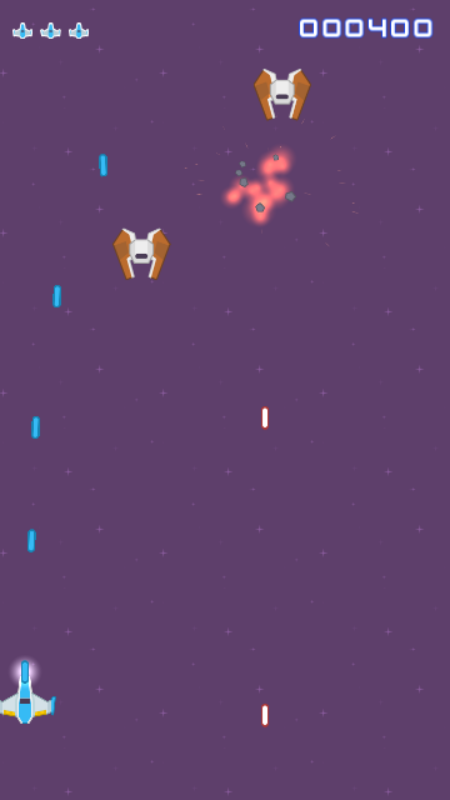

# TD Shoot them up 2D - Spaceship

<p align="center"></p>

L'objectif de ce TD est de construire un shoot'em up vertical en 2D sur mobile.
C'est un genre de jeu avec score infini, qui comporte des mécaniques simples, mais qui peuvent être grandement améliorés via des petites étapes de polish.
Le TD se déroule en deux parties:
- La création des core mecaniques (déplacement du vaisseau, apparition d'ennemis, ect) ainsi que l'export mobile
- L'amélioration d'un jeu classique via du **juice**

## Structure du TD

Le TD est structurée sous forme de boucles, qui elles même contiennent plusieurs étapes.
Chaque boucle dure environ 1 h et suit toujours le même rythme :

| | |
|---|---|
| 🎓 **Capsule** | 10 min de présentation au tableau. Présentation de ce qu'on va aborder dans le point. |
| 🛠️ **Socle** | Ce que tout le monde doit avoir à la fin de la boucle. |
| ✨ **Juice pass** | On rend agréable ce qu'on vient de coder. |
| ✅ **Checkpoint** | Ce que vous devez voir en lançant le jeu (F5). |
| 🥉 🥈 🥇 | Défis pour celles et ceux qui ont fini, avec 3 niveaux de diffcultées. |

Les indices sont repliés : cliquez sur **💡 Indice** seulement si vous bloquez.

> 🚫 **Pas d'IA générative dans ce TD.** Vous apprenez à faire : je suis là pour répondre à toutes vos questions, et la doc Godot (F1 dans l'éditeur, ou Ctrl+clic sur une fonction dans un script), le cours ainsi que vos voisins sont vos alliés.

## Ce qui vous est fourni

- **Les réglages du projet** : écran au format portrait **720×1280** (`Display > Window`), noms des couches de collision (`Layer Names > 2D Physics`).
- `KennyAssets/` : les sprites, polices et quelques sons ([Kenney](https://kenney.nl), licence CC0).
- `Effects/` : **des effets prêts à l'emploi**. Vous n'avez pas à les fabriquer, seulement à les jouer au bon endroit.

| Fichier | Contenu |
|---|---|
| `Effects/explosion.tscn` | Flash + boule de feu + étincelles + son d'explosion |
| `Effects/hit_spark.tscn` | Petites étincelles + son d'impact |
| `Effects/muzzle_flash.tscn` | Flash au bout du canon |
| `Effects/debris.tscn` | Débris qui flottent et retombent lentement |
| `Effects/Sounds/sfx_laser.tres` | Sons de tir, pitch aléatoire |
| `Effects/Sounds/sfx_player_hurt.tres` | Son de dégât du joueur |

Toutes les scènes de `Effects/` démarrent **toutes seules** quand elles apparaissent, puis **se détruisent toutes seules**. 
Pour en jouer une : on l'instancie, on la place, on l'ajoute à la scène.

## Mise en place (une seule fois)

1. Sur la page de ce dépôt, cliquez sur **Use this template > Create a new repository**. Propriétaire : votre compte GitHub. Visibilité : **Private**.
2. Dans votre nouveau dépôt, **Settings > Collaborators > Add people** : ajoutez `YannickMontes`.
3. Collez l'adresse de votre dépôt dans le **Google Sheet de la promo** (le lien est donné en cours). C'est ce dépôt qui sera noté.
4. Clonez votre dépôt, ouvrez un terminal dans son dossier (Git Bash, PowerShell ou cmd) et ajoutez le dépôt du prof, pour les checkpoints :

```
git remote add prof https://github.com/YannickMontes/2D-Space-Shooter-Template.git
```

Ouvrez ensuite le projet avec **Godot 4.6**.

## 🆘 En retard ? Récupérer un checkpoint

À chaque boucle de la partie 1 correspond un **checkpoint** : le projet tel qu'il doit être à la fin de la boucle (socle et juice pass, sans les défis). Si vous êtes en retard, ou si votre projet ne marche plus, repartez de là. Il n'y a pas de checkpoint pour la partie 2 : c'est elle qui est notée.

Il faut avoir ajouté le dépôt du prof (étape 4 de la mise en place).

**Pour récupérer un checkpoint**, **Godot fermé**, copiez ces lignes en remplaçant `1.3` par la boucle voulue :

```
git add -A
git commit -m "Ma version avant le checkpoint 1.3"
git tag ma-version-1.3
git fetch prof --tags
git checkout checkpoint-1.3 -- . ":(exclude)README.md"
git add -A
git commit -m "Checkpoint 1.3 récupéré"
```

- Les fichiers du checkpoint **remplacent les vôtres quand ils ont le même nom**. Vos autres fichiers et votre README ne bougent pas.
- ⚠️ Les trois premières lignes sauvegardent votre travail : ne les sautez jamais.
- ⚠️ Gardez bien le `-- .` : sans lui, git vous déplace sur le checkpoint au lieu de copier ses fichiers, et vos commits suivants ne partent plus sur GitHub. Si ça arrive : `git checkout main`.

<details><summary>Revenir à votre version, ou ne prendre que ce qui vous manque</summary>

Votre version d'avant est gardée sous le nom `ma-version-1.3` :

```
git checkout ma-version-1.3 -- .                  # tout reprendre
git checkout ma-version-1.3 -- Scripts/player.gd  # reprendre un seul fichier
git diff ma-version-1.3 -- Scripts/player.gd      # voir ce que le prof a fait autrement
```

Si une seule partie vous manque, prenez seulement ses fichiers (avec le `.uid` de chaque script), par exemple l'arme de la boucle 1.3 :

```
git checkout checkpoint-1.3 -- Scenes/weapon.tscn Scripts/weapon.gd Scripts/weapon.gd.uid
```

| Checkpoint | Fichiers ajoutés | Fichiers modifiés |
|---|---|---|
| 1.1 | `Scenes/main.tscn`, `Scenes/player.tscn` | `project.godot` (scène principale) |
| 1.2 | `Scripts/player.gd` | `Scenes/player.tscn`, `project.godot` (Input Map) |
| 1.3 | `Scenes/bullet.tscn`, `Scenes/weapon.tscn`, `Scripts/bullet.gd`, `Scripts/weapon.gd` | `Scenes/player.tscn` |
| 1.4 | `Scenes/enemy.tscn`, `Scenes/enemy_spawner.tscn`, `Scripts/enemy.gd`, `Scripts/enemy_spawner.gd` | `Scenes/main.tscn`, `Scenes/player.tscn`, `Scenes/bullet.tscn`, `Scripts/player.gd`, `Scripts/bullet.gd` |
| 1.5 | `Scenes/hud.tscn`, `Scripts/hud.gd`, `Scripts/game_manager.gd` | `Scenes/main.tscn`, `Scripts/player.gd`, `Scripts/enemy.gd`, `project.godot` (autoload) |
| 1.6 | `export_presets.cfg` | `Scripts/player.gd` |

Si `git status` affiche encore un de vos fichiers avec une majuscule (`Player.gd` au lieu de `player.gd`), Windows et git ne sont plus d'accord sur son nom. Retirez l'ancien nom de git, puis faites un commit :

```
git rm --cached Scripts/Player.gd
```

Sans git : sur la page [des tags](https://github.com/YannickMontes/2D-Space-Shooter-Template/tags), téléchargez le zip du checkpoint et copiez son contenu par-dessus votre projet, **sauf le README**. Faites un commit avant.

</details>

---

# 1. La construction du jeu

## 1.1 Nœuds et scènes

🎓 **Capsule** : Nœud, arbre de scène, scène = nœud réutilisable, instance, `Sprite2D`, `Camera2D`.

🛠️ **Socle**

1. Créez la scène `Scenes/main.tscn`, avec un `Node2D` nommé **Main** comme racine. Faites-en la scène principale (clic droit dans le FileSystem > *Set as Main Scene*).
2. Ajoutez une `Camera2D` en position `(0, 0)` dans le monde. Avec la résolution du projet, l'écran va de **-360 à 360 en X** et de **-640 à 640 en Y**.
3. Ajoutez un fond : un `Sprite2D` avec `Backgrounds/purple.png`.
   - Pour qu'il couvre tout l'écran, avec de la marge pour les secousses de caméra à venir : Sélectionnez le sprite, et dans l'inspecteur `Region > Enabled`, `Rect` = `(0, 0, 1024, 2304)`.
   - A nouveau dans l'inspecteur, `CanvasItem > Texture > Repeat` = `Enabled`.
4. Créez la scène `Scenes/player.tscn` : un node racine de type **`Area2D`** nommée **Player**, avec un enfant `Sprite2D` (`playerShip1_blue.png`).
   > Le triangle jaune ⚠️ sur l'`Area2D` est normal : on lui donnera une forme de collision plus tard (en 1.4)
5. Instanciez `Player` dans `Main`, en `(0, 480)`.

✅ **Checkpoint** : F5, et votre vaisseau est en bas d'un écran violet, au format portrait.

🥉 Changez la couleur du vaisseau.

---

## 1.2 Script, delta, inputs et vecteurs

🎓 **Capsule** : `_ready`, `_process(delta)` et `_physics_process(delta)`, pourquoi multiplier par `delta`, l'Input Map, `Vector2` (direction × vitesse), le typage statique.

> 📌 **La règle à retenir**
> - Tout ce qui **déplace un objet qui a une collision** va dans `_physics_process` : fixé à 60 appels par seconde, c'est ici que Godot vérifie les contacts.
> - Le reste va dans `_process` : chronomètres, effets visuels, caméra, interface... 

> 🔒 **Ici, on type tout**
> - Le projet refuse les variables sans type (`Project Settings > Debug > GDScript > Untyped Declaration` = `Error`) : une ligne comme `var direction = Vector2.ZERO` est soulignée en rouge et le jeu ne se lance pas.
> - Le type s'écrit toujours en toutes lettres. Vous croiserez `var direction := Vector2.ZERO` sur Internet : ici, il est refusé aussi (`Inferred Declaration` = `Error`).
> - Variables, `@export`, paramètres et retours de fonction : `var speed: float = 600.0`, `func take_damage(amount: int) -> void:`.
> - Même la variable d'une boucle : `for i: int in 3:`.
> - En échange, Godot vous signale les erreurs **avant** de lancer le jeu, et l'autocomplétion connaît vos variables : tapez `enemy.` et elle propose `take_damage()`.

🛠️ **Socle**

1. Dans `Project > Project Settings > Input Map`, créez trois actions :
   - `move_left` : flèche gauche + touche **A en « Physical »**, qui correspond à **Q** sur un clavier AZERTY ;
   - `move_right` : flèche droite + **D** ;
   - `touch` : clic gauche de la souris. Sur téléphone, un doigt posé compte comme un clic gauche.
2. Attachez un script `Scripts/player.gd` au Player, avec `class_name Player` :
   - une vitesse exportée (`@export var speed: float`) ;
   - une variable `velocity: Vector2` ;
   - dans `_physics_process(delta)`, lisez la direction, calculez `velocity`, puis déplacez le vaisseau : `position += velocity * delta`. Le vaisseau aura une collision en 1.4, d'où `_physics_process` ;
   - empêchez le vaisseau de sortir de l'écran en X.
3. Au doigt : **tant que** `touch` est enfoncé, le vaisseau rejoint la position X du doigt.

<details><summary>💡 Indice : lire le clavier</summary>

`Input.get_axis("action_negative", "action_positive")` renvoie `-1` si seule la première action est enfoncée, `1` si seule la seconde l'est, et `0` sinon.

</details>

<details><summary>💡 Indice : suivre le doigt</summary>

- `Input.is_action_pressed("action")` renvoie `true` tant que l'action est enfoncée.
- `get_global_mouse_position()` donne la position du doigt (ou de la souris) **dans le monde**, comme `global_position`.
- L'idée : plus le doigt est loin du vaisseau, plus la direction est forte, sans jamais dépasser 1. Divisez la distance par une soixantaine de pixels, puis bornez le résultat avec `clamp` (voir l'indice suivant).

</details>

<details><summary>💡 Indice : rester dans l'écran</summary>

`clamp(valeur, min, max)` renvoie la valeur, ramenée entre `min` et `max` :

```gdscript
clamp(15, 0, 10)  # 10
clamp(-3, 0, 10)  # 0
clamp(7, 0, 10)   # 7
```
</details>

✨ **Juice pass : donner du poids au vaisseau**
- **Accélération et freinage** : au lieu de `velocity = direction * speed`, faites tendre `velocity` vers sa cible avec `velocity.move_toward(cible, acceleration * delta)`. Comparez avec et sans.
- **Inclinaison** : le `Sprite2D` (et non le Player) penche dans le sens du mouvement, proportionnellement à `velocity.x`. Une quinzaine de degrés au maximum (`deg_to_rad`).

✅ **Checkpoint** : le vaisseau glisse au clavier et suit la souris quand on maintient le clic. Il ne sort pas de l'écran et il penche dans les virages.

🥈 Autorisez aussi le déplacement vertical, mais uniquement dans le tiers bas de l'écran.

---

## 1.3 Instancier des scènes, le tir

🎓 **Capsule** : `PackedScene`, `instantiate()`, `add_child()`, `queue_free()`, un cooldown décompté avec `delta`, `AudioStreamPlayer2D`.

🛠️ **Socle**

1. Créez `Scenes/bullet.tscn` : une racine `Area2D` nommée **Bullet**, un `Sprite2D` (`Lasers/laserBlue02.png`) et une `CollisionShape2D` en rectangle ajustée au laser.
2. Script `Scripts/bullet.gd` (`class_name Bullet`) : dans `_physics_process`, le tir monte tout droit, à une vitesse exportée. Il se détruit (`queue_free()`) quand il sort de l'écran.
3. Créez `Scenes/weapon.tscn` : un `Node2D` nommé **Weapon**, avec le script `Scripts/weapon.gd`.
   - Il a une `@export var bullet_scene: PackedScene` et une `@export var time_between_shots: float` (en secondes).
   - Il tire **automatiquement** à cette cadence.
   - Le tir est ajouté à la **scène courante**, pas comme enfant de l'arme, sinon il suivrait le vaisseau.
4. Instanciez `Weapon` dans la scène `Player`, au bout du nez du vaisseau. Glissez `bullet.tscn` dans `Bullet Scene`.

<details><summary>💡 Indice : un cooldown avec delta</summary>

- Une variable `cooldown` contient le temps restant avant le prochain tir, en secondes.
- À chaque frame, elle diminue du temps écoulé depuis la frame précédente. Quelle variable contient ce temps ?
- Quand elle passe sous 0 : on tire, puis on la remet à `time_between_shots`.
- Un chronomètre ne déplace rien : `_process` suffit.

</details>

<details><summary>💡 Indice : faire apparaître une scène</summary>

Trois étapes :
1. **Instancier** : `ma_scene.instantiate()` crée une copie de la scène et la renvoie.
2. **Placer** : on règle sa `global_position` (ou sa `rotation`...) avant de l'ajouter.
3. **Ajouter à l'arbre** : sans `add_child(...)`, elle n'existe pas dans le jeu. Pour l'ajouter à la scène courante, et non à l'arme : `get_tree().current_scene`.

`instantiate()` renvoie un simple `Node`. Si vous rangez le résultat dans une variable de type `Bullet`, Godot vérifie que c'est bien la bonne scène qui a été glissée dans l'inspecteur.

</details>

✨ **Juice pass : que chaque tir se sente**
- **Son** : ajoutez un `AudioStreamPlayer2D` nommé `Sound` dans Weapon, avec `Effects/Sounds/sfx_laser.tres`, et jouez-le à chaque tir. Ouvrez le `.tres` : *Random Pitch* fait varier la hauteur du son à chaque fois. Comparez avec un son fixe.
- **Flash** : à chaque tir, instanciez `Effects/muzzle_flash.tscn` **comme enfant de l'arme**, pour qu'il suive le vaisseau.
- **Dispersion** : donnez au tir une rotation aléatoire de quelques degrés (ex ±3°). Le tir avance dans **sa propre direction** (et pas celle du vaisseau): `position += Vector2.UP.rotated(rotation) * speed * delta`.

✅ **Checkpoint** : le vaisseau tire en continu, avec son et flash, et les tirs disparaissent en haut de l'écran.

🥉 Changez la cadence de tir depuis l'inspecteur, sans toucher au code.

---

## 1.4 Physique, collisions et signaux

🎓 **Capsule** :
- `Area2D`, `CharacterBody2D`, `RigidBody2D`, `StaticBody2D` : lequel choisir ?
- Ici, rien ne doit se *bloquer*, tout doit seulement se *détecter* : donc des `Area2D`.
- Les couches de collision : le *layer*, c'est « je suis », le *mask*, c'est « je détecte ».
- Les signaux, connectés depuis l'éditeur (onglet *Node > Signals*) ou depuis le code.
- Le nœud `Timer`.

🛠️ **Socle**

1. Réglez les couches dans l'inspecteur, rubrique `Collision`. Les noms sont déjà définis dans le projet.

| Scène | Layer (« je suis ») | Mask (« je détecte ») |
|---|---|---|
| Player | 1 Player | *aucun* |
| Enemy | 2 Enemies | 1 Player |
| Bullet | 3 PlayerBullets | 2 Enemies |

2. Ajoutez une `CollisionShape2D` au Player, **un peu plus petite que le sprite**. Une hitbox tolérante, c'est déjà du game feel.
3. Créez `Scenes/enemy.tscn` : une racine `Area2D` nommée **Enemy**, un `Sprite2D` (`Enemies/enemyRed1.png`) et une `CollisionShape2D`. Script `Scripts/enemy.gd` (`class_name Enemy`) :
   - il descend à vitesse constante (dans `_physics_process`) et se détruit une fois sorti par le bas ;
   - il a 2 points de vie et une fonction `take_damage(amount: int)`, qui le détruit à 0.
4. Les collisions, avec le signal `area_entered` :
   - **Bullet** : si ce qu'il touche possède `take_damage`, il l'appelle, puis le tir se détruit ;
   - **Enemy** : s'il touche le Player, le Player prend 1 dégât et l'ennemi se détruit.
5. Dans `player.gd`, ajoutez des points de vie et `take_damage(amount: int)`. À 0 point de vie, rechargez la scène pour l'instant, à la fin de la frame : `get_tree().reload_current_scene.call_deferred()`. On fera mieux en 1.5.
6. Créez `Scenes/enemy_spawner.tscn` : un `Node2D` avec un `Timer` enfant. À chaque fin du Timer, il fait apparaître un ennemi à une position X aléatoire. Placez le spawner dans Main en `(0, -850)`, au-dessus de l'écran.

<details><summary>💡 Indice : toucher sans connaître le type exact</summary>

- Le signal `area_entered` vous donne l'`Area2D` touchée en paramètre.
- `objet.has_method("nom_de_la_fonction")` renvoie `true` si l'objet possède cette fonction. Le tir n'a donc pas besoin de savoir s'il touche un ennemi, un astéroïde ou autre chose.

</details>

<details><summary>💡 Indice : position aléatoire</summary>

`randf_range(min, max)` renvoie un nombre décimal aléatoire entre `min` et `max`.

</details>

✨ **Juice pass : que chaque coup se sente**
- **Flash blanc** quand l'ennemi est touché :
  - mettez `sprite.modulate = Color(10, 10, 10)` (une valeur > 1 rend le sprite blanc) ;
  - lancez un `Timer` enfant, *One Shot*, de 0,06 s ;
  - à sa fin, remettez `Color.WHITE`.
- **Knockback** : quand il est touché, l'ennemi est repoussé vers le haut (`velocity.y = -knockback`). Il revient ensuite progressivement à sa vitesse normale, avec `move_toward` comme en 1.2. L'ennemi a donc besoin de sa propre variable `velocity`.
- **Explosion** : quand l'ennemi meurt, instanciez `Effects/explosion.tscn` à sa position.
- **Impact** : quand un tir touche, instanciez `Effects/hit_spark.tscn` à la position du tir.

✅ **Checkpoint** : les ennemis descendent, clignotent et reculent sous les tirs, puis explosent. Toucher un ennemi fait perdre une vie, et la partie recommence à 0.

---

## 1.5 GameManager, interface et tweens

🎓 **Capsule** : autoload (singleton), signaux personnalisés, `CanvasLayer`, nœuds `Control` et ancres (pensez en pourcentage d'écran), mettre le jeu en pause, `Tween` et courbes d'easing ([easings.net](https://easings.net)).

🛠️ **Socle**

1. Créez `Scripts/game_manager.gd` (`extends Node`) et ajoutez-le en autoload sous le nom **GameManager** (`Project Settings > Globals > Autoload`).
   > ⚠️ Pas de `class_name GameManager` dans ce script : Godot refuse une classe qui porte le nom d'un autoload.
   - Il contient le `score` et trois signaux : `score_changed(score: int)`, `player_life_changed(life: int)`, `game_over`.
   - `add_score(points: int)` ajoute les points et émet `score_changed`.
   - `trigger_game_over()` met le jeu en pause (`get_tree().paused = true`) et émet `game_over`.
   - `restart()` remet le score à 0, enlève la pause et recharge la scène.
2. L'ennemi tué par un tir appelle `GameManager.add_score(...)`. Le Player émet `player_life_changed` quand il est touché et appelle `trigger_game_over()` à 0 point de vie.
3. Créez `Scenes/hud.tscn` : une racine `CanvasLayer` nommée **HUD**, à instancier dans Main. Elle contient :
   - un `Label` de score **ancré en haut à droite**, avec la police `Bonus/kenvector_future.ttf` ;
   - les vies : un `HBoxContainer` en haut à gauche, avec 3 `TextureRect` (`UI/playerLife1_blue.png`) ;
   - un panneau de game over caché, avec deux boutons, **Rejouer** et **Quitter**.
4. Script `hud.gd` : dans `_ready`, connectez-vous aux signaux du GameManager. Mettez à jour le score et les vies, et affichez le panneau au game over.
5. Le jeu est en pause au game over, mais **le HUD doit continuer à fonctionner** : `Process > Mode = Always` sur le HUD.

<details><summary>💡 Indice : se connecter à un signal en code</summary>

La syntaxe est `noeud.nom_du_signal.connect(fonction_a_appeler)`. Par exemple, avec un Timer :

```gdscript
func _ready() -> void:
	$Timer.timeout.connect(_on_timer_timeout)

func _on_timer_timeout() -> void:
	print("Fin du timer")
```

Elle fonctionne de la même façon avec un autoload. La fonction appelée doit accepter les paramètres du signal.

Pour afficher le score sur 6 chiffres : `"%06d" % 420` donne `"000420"`.

</details>

✨ **Juice pass : une interface vivante**
- **Score qui « punch »** : à chaque gain, le label passe à l'échelle 1,4 puis revient à 1 avec un `Tween` en `TRANS_BACK`. Pensez au `pivot_offset` (le centre du label), sinon il grossit depuis son coin.
- **Flash rouge** : un `ColorRect` rouge plein écran, transparent, avec `Mouse Filter = Ignore`. Quand le joueur est touché, son alpha passe à 0,4 puis redescend à 0 avec un tween.

<details><summary>💡 Indice : un tween</summary>

`tween_property(noeud, "propriété", valeur_finale, durée)` fait passer une propriété de sa valeur actuelle à `valeur_finale`. Par exemple, faire faire un demi-tour à un sprite en 0,5 s :

```gdscript
create_tween().tween_property(sprite, "rotation", PI, 0.5)
```

- La courbe se choisit en ajoutant `.set_trans(Tween.TRANS_...)` et `.set_ease(Tween.EASE_...)` à la fin. Comparez-les sur [easings.net](https://easings.net).
- On peut animer une seule composante : `"color:a"`, `"modulate:a"`, `"position:x"`...

</details>

✅ **Checkpoint** : le score grossit à chaque ennemi détruit, une icône de vie disparaît à chaque coup, l'écran flashe en rouge. À 0 vie, le jeu se fige, le panneau apparaît, et **Rejouer** relance une partie propre.

---

## 1.6 Sur votre téléphone

🎓 **Capsule** : `Project > Export`, les presets Android et Web, pourquoi le Web pour les iPhone (l'export iOS exige un Mac), lancer le jeu sur le téléphone ou dans le navigateur depuis l'éditeur.

🛠️ **Socle**

1. **Android** :
   - sur le téléphone, activez les *Options pour les développeurs*, puis le *Débogage USB* ;
   - branchez-le au PC et acceptez « Autoriser le débogage USB ? » sur le téléphone ;
   - dans `Project > Export`, ajoutez un preset Android, cochez **Exécutable** et la permission **Vibrate** ;
   - l'icône Android apparaît en haut à droite de l'éditeur : un clic, et le jeu se lance sur le téléphone.
2. **Web**, pour tout le monde :
   - ajoutez un preset Web et cochez **Exécutable** ;
   - l'icône navigateur, en haut à droite de l'éditeur, lance le jeu dans le navigateur du PC ;
   - passez en mode téléphone avec **F12**, puis **Ctrl+Maj+M** : le clic y joue le rôle du doigt.
3. Jouez **au doigt**. Ajustez la vitesse ou la taille des sprites si c'est injouable.

> Pas besoin de mettre le jeu en ligne : l'éditeur le sert lui-même au navigateur du PC.

✨ **Juice pass : le retour haptique**
- Quand le joueur est touché : `Input.vibrate_handheld(150)` (durée en millisecondes).
- Ça marche sur Android, en APK comme dans le navigateur. Sur iPhone, le navigateur l'ignore.

✅ **Checkpoint** : le jeu tourne au doigt sur votre téléphone Android, ou dans le navigateur du PC en mode téléphone, et ça vibre quand vous êtes touché (sur Android).

🥉 Donnez une icône à votre jeu, sur ordi comme sur téléphone.

<details><summary>💡 Indice</summary>

L'icône du jeu se règle dans les *Project Settings*, rubrique `Application`. Sur Android, le preset d'export a aussi sa propre rubrique d'icônes : regardez ce qu'elle attend.

</details>

---

## 1.7 Défis

- 🥉 **Fond qui défile** : le fond défile en boucle vers le bas.

  <details><summary>💡 Indice</summary>

  Le nœud `Parallax2D` fait défiler et boucler son contenu : regardez `Autoscroll` et `Repeat Size` (la taille d'une tuile du fond, 256 px).

  Si le bas de l'écran se découvre par moments : sur le `Sprite2D`, décochez `Centered` et placez-le en `(-512, -128)`.

  </details>

- 🥈 **Ennemi qui ondule** : un nouvel ennemi qui descend en zigzag, **sans recopier** le code de l'ennemi de base.

  <details><summary>💡 Indice</summary>

  Clic droit sur une scène > *New Inherited Scene*, et un script qui `extends Enemy`. Une fonction redéfinie peut appeler la version du parent avec `super()`. Pour onduler : `sin()`.

  </details>

- 🥈 **Ennemi qui tire** : un ennemi qui tire vers le bas, en réutilisant **votre** arme.

  <details><summary>💡 Indice</summary>

  Votre tir avance déjà dans *sa* direction : que se passe-t-il si l'arme est tournée ? Le tir ennemi doit toucher le joueur, pas les ennemis : pensez aux layers et aux masks.

  </details>

- 🥇 **Variété** : le spawner choisit au hasard parmi plusieurs types d'ennemis.
- 🥇 **Difficulté progressive** : les ennemis arrivent de plus en plus vite, jusqu'à une limite.

---

# 2. Le juice

> **Avant de toucher au code**, filmez **10 secondes de votre jeu** : téléphone, `Win + Alt + R`, ou [ScreenToGif](https://www.screentogif.com/). C'est votre vidéo **« avant »**, et elle fait partie de la note. Déposez-la dans le dossier `Rendu/`, avec un nom du genre `Avant.gif`.

## 2.1 Game feel et caméra

🎓 **Capsule** :
- Les 3 piliers du game feel (Steve Swink) : contrôle en temps réel, espace simulé, polish.
- Extraits de *Juice it or lose it* (Jonasson & Purho) et de *The Art of Screenshake* (Nijman).
- Le screen shake par « trauma » et le hitstop.

🛠️ **Socle**

1. **Screen shake** : script `Scripts/camera_shake.gd` sur la Camera2D. On cumule du `trauma`, entre 0 et 1, qui redescend tout seul avec le temps.
   - Chaque frame : `offset` et `rotation` aléatoires, proportionnels à **trauma²**. Pour que la rotation compte, décochez `Ignore Rotation` sur la caméra.
   - La caméra se connecte à `player_life_changed` : gros trauma quand le joueur est touché, trauma maximum à sa mort.
   - L'ennemi qui meurt ajoute un petit trauma : `get_viewport().get_camera_2d().add_trauma(0.25)`.
   - Pour que la caméra secoue encore pendant la pause du game over : `Process > Mode = Always`.
2. **Hitstop** : `GameManager.hitstop(duree)` fige presque le jeu un court instant, avec `Engine.time_scale = 0.05`, puis le remet à 1.
   - Appelez-le à la mort d'un ennemi (environ 0,04 s) et quand le joueur est touché (environ 0,1 s).

<details><summary>💡 Indice : le shake par trauma</summary>

À chaque frame, dans l'ordre :
1. `trauma` baisse de `decay × delta`, sans passer sous 0 : `max(a, b)` renvoie la plus grande des deux valeurs.
2. On calcule `shake`, qui vaut trauma².
3. `offset` est un vecteur dont chaque composante est tirée au hasard entre -1 et 1, multiplié par l'amplitude maximale et par `shake`. Même principe pour `rotation`.

</details>

<details><summary>💡 Indice : un timer qui ignore le ralenti</summary>

```gdscript
# create_timer(durée, process_always, process_in_physics, ignore_time_scale)
await get_tree().create_timer(duration, true, false, true).timeout
```
Sans le dernier `true`, le timer est lui aussi ralenti 20 fois.

</details>

## 2.2 Sons, particules et permanence

🎓 **Capsule** : le son, c'est la moitié du feedback. La permanence : le monde garde des traces de ce qui s'est passé. Les frames d'invincibilité.

🛠️ **Socle** : jouez les effets fournis au bon endroit.
1. **Dégât du joueur** : un `AudioStreamPlayer2D` avec `Effects/Sounds/sfx_player_hurt.tres`.
2. **Débris** : à la mort d'un ennemi, instanciez `Effects/debris.tscn` en plus de l'explosion.
3. **Mort du joueur** : une explosion **deux fois plus grosse** (`scale`) à sa position, puis `GameManager.trigger_game_over()`.
4. **Invincibilité** : après un coup, le joueur ne peut plus être touché pendant environ 1 s et clignote. Utilisez un tween de `modulate:a`, avec `set_loops()`.

<details><summary>💡 Indice : clignoter avec un tween</summary>

- Deux `tween_property` écrits l'un après l'autre sur le même tween s'enchaînent : le second démarre quand le premier est fini.
- `create_tween().set_loops(n)` rejoue toute la séquence `n` fois.
- Le signal `finished` du tween est émis quand tout est terminé. Pour exécuter une seule ligne à ce moment-là, sans écrire de fonction à part, on peut connecter une fonction anonyme :

```gdscript
tween.finished.connect(func() -> void: print("terminé"))
```
</details>

## 2.3 Animer

🎓 **Capsule** : enchaîner les tweens et les jouer en parallèle (`set_parallel()`), `TRANS_BACK` et `TRANS_ELASTIC`, squash & stretch, ralenti.

🛠️ **Socle**
1. **Apparition en pop** : un ennemi naît à l'échelle 0 et grandit jusqu'à 1 en `TRANS_BACK`.
2. **Squash & stretch** : quand il est touché, le sprite passe à `(1.3, 0.7)` puis revient à `(1, 1)` en `TRANS_ELASTIC`. Si un tween d'échelle tourne encore, `kill()`-ez-le d'abord.
3. **Ralenti de game over** : `Engine.time_scale = 0.3` pendant 1 s réelle, *puis* pause et panneau.
4. **Arrivée du panneau** : il apparaît avec un rebond (échelle 0,3 → 1 en `TRANS_BACK`) et un fondu, en parallèle.

## 2.4 Carte de juice

Piochez librement. Plus vous montez, plus ça rapporte. Remplissez la colonne **Fait** dans **votre** README (voir [Votre rendu](#3--votre-rendu-à-compléter-dans-ce-readme)).

<div align="center">

| | Effet | Vu en | Fait |
|---|---|---|:---:|
| 🥉 | Flash blanc à l'impact | 1.4 |  |
| 🥉 | Son de tir avec pitch aléatoire | 1.3 |  |
| 🥉 | Explosion et étincelles d'impact | 1.4 |  |
| 🥉 | Score qui punch, flash rouge au dégât | 1.5 |  |
| 🥈 | Screen shake par trauma | 2.1 |  |
| 🥈 | Hitstop | 2.1 |  |
| 🥈 | Débris (permanence) | 2.2 |  |
| 🥈 | Invincibilité qui clignote | 2.2 |  |
| 🥈 | Pop d'apparition, squash & stretch | 2.3 |  |
| 🥇 | Ralenti de game over, panneau qui rebondit | 2.3 |  |
| 🥇 | Recul du vaisseau à chaque tir (le sprite recule puis revient) | Libre |  |
| 🥇 | Score flottant (« +100 ») qui monte et disparaît à la position de l'ennemi | Libre |  |
| 🥇 | Traînée derrière les tirs (`Line2D` ou particules) | Libre |  |
| 🥇 | Shake plus doux avec `FastNoiseLite` au lieu de `randf_range` | Libre |  |
| 🥇 | Le fond défile plus vite quand la difficulté monte | Libre |  |
| 🥇 | Vibration dosée selon l'événement (tir, coup, mort) | Libre |  |

</div>

---

# 3. 📋 Votre rendu (à compléter dans ce README)

- **Nom / Prénom** : …
- **Vidéo avant / après** : déposez vos deux vidéos ou GIF dans `Rendu/` et affichez-les ici.
- **Ma carte de juice** : dans la colonne **Fait** de la [carte de juice](#24-carte-de-juice), mettez ✅ si vous l'avez fait, ❌ sinon (copiez-collez l'emoji). Pour chaque ✅, indiquez ici où (script, fonction).
